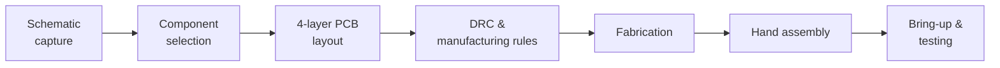

<div align="center">

# 📶 ESP32-C3 Development Board

**Custom 4-layer Wi-Fi & Bluetooth LE development board with USB Type-C and an inverted-F antenna, designed in Altium Designer and assembled by hand.**


</div>

<p align="center">
  
  
</p>

---

## 📌 Overview

This project is a custom **4-layer ESP32-C3 development board** designed in **Altium Designer**. The goal was to gain practical experience in the full hardware workflow: schematic capture, PCB layout, manufacturing preparation, hand assembly and bring-up. The design follows the ESP32-C3 datasheet and the Espressif hardware design guidelines.

The board was manufactured and then assembled by hand to validate the complete design workflow.

---

## ✨ Features

| Area | Implementation |
|---|---|
| **MCU** | ESP32-C3, Wi-Fi and Bluetooth LE |
| **Interface** | USB Type-C |
| **Power** | 3.3 V supply with decoupling and power filtering |
| **RF** | Inverted-F antenna with antenna keep-out region |
| **PCB** | 4-layer stack-up with ground-plane optimization |
| **User I/O** | Reset and Boot buttons, status LED |
| **Programming** | Programming and debug interface |
| **Verification** | Design Rule Check (DRC) passed before fabrication |

<!-- TODO: add board size, regulator part number, USB programming method and layer stack (e.g. Signal / GND / Power / Signal) to the table above. -->

---

## 🔬 Hardware Design Process



- Created the complete schematic in Altium Designer, based on the ESP32-C3 reference design
- Designed a compact 4-layer PCB with proper power distribution and decoupling
- Routed the USB differential pair
- Applied the RF antenna keep-out recommendations
- Configured design rules for manufacturing and hand soldering
- Ran Design Rule Checks before fabrication

---

## 🖼️ PCB Preview

| Top View | Bottom View |
|:---:|:---:|
|  |  |

| 3D Front | 3D Rear |
|:---:|:---:|
|  |  |

---

## 🛠️ Assembly

The PCB was assembled manually by hand soldering:

- ESP32-C3 module
- USB Type-C connector
- Passive components
- Power supply circuitry
- Headers and supporting components

<!-- Optional: add a photo of the assembled board here:  -->

---

## ✅ Testing & Bring-up

| Check | Status |
|---|:---:|
| Visual inspection | ✅ |
| Continuity testing | ✅ |
| Power rail verification | ✅ |
| USB connectivity | ✅ |
| ESP32-C3 programming | ✅ |
| Basic functional testing | ✅ |

<!-- Optional: add measured results, e.g. 3.3 V rail voltage, current draw, Wi-Fi / BLE test. -->

---

## 📂 Repository Structure

```
ESP32-C3-Development-Board/
├── Hardware_Images/        # PCB top / bottom views and 3D renders
├── Hardware_Design_PDF/    # Schematic and PCB design documents
└── README.md
```

📄 **[Hardware design PDF →](Hardware_Design_PDF/)**

---

## 🎓 Skills Demonstrated


-1E3A5F?style=flat-square)


---

## 📝 Disclaimer

This is a learning and portfolio project, based on publicly available documentation, manufacturer reference designs and hardware design guidelines. Its purpose is to demonstrate practical PCB design, layout, assembly and hardware validation skills. It is not a certified or production-ready product.

---

## 👤 Author

**Maulik Italiya**: Embedded Hardware & Systems · M.Sc. Embedded Systems Design, Hochschule Bremerhaven

[](https://www.linkedin.com/in/maulik-italiya/)
[](https://github.com/MaulikItaliya)
